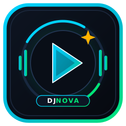

<p align="center">
  
</p>

<h1 align="center">DJNova</h1>
<p align="center">
  <b>Consola Profesional de Cabina DJ, AutoDJ Sin Cortes, Radio Streaming, Escenario Video y Transmisión en Vivo</b><br/>
  <sub>Multiplataforma (Linux & Windows) • 100% en Español • Licencia GNU GPL-3.0</sub>
</p>

---

## Características Principales

- **Consola DJ Superior (`CONSOLA DJ`):** reloj de cabina LED, grabador de mezcla en vivo `● REC` (MP3 320 kbps), botones `FADE / PAUSA / PLAY / STOP`, Crossfade maestro (`XFADE ▶`), fader maestro, **`DIM [0]` (-12 dB con tecla `0`)**, `MUTE`, `TAP BPM` y cambio de temas en vivo (`DjConsoleNeon`, `BroadcastDesk`, `ClubCarbonRed`).
- **Playlist Continua / AutoDJ (`Non-Stop Deck`):** integrada junto al botón `GO`. Arrastra temas desde tu lista manual o desde tus carpetas, elige empalme sin silencios (`0s Cero cortes` o `Crossfade 2s/3s/5s`), modo `BUCLE` y salto suave.
- **Ecualizador DJ 3 Bandas (`EQ DJ 3B`):** perillas rotatorias (`AGUDOS`, `MEDIOS`, `GRAVES`), botones `KILL` instantáneos y presets rápidos (`FLAT`, `BASS`, `VOZ`, `RADIO`).
- **Banco Sampler FX (`1–8` + `9: Stop`):** 8 pads neón precargados con efectos normalizados de dominio público (Bocina DJ, Aplausos, Redoble, Fanfarria, Scratch, Risas, Fail Trombón, Sirena) + 10 extras incluidos en `assets/sfx/Extras`.
- **Auto-Master Inteligente (`⚡ AUTO EQ`):** análisis FFT de 10 bandas, compresión dinámica suave y nivelación RMS automática (`-14 dB`).
- **Descarga Directa de YouTube (`YT+` / `Ctrl+Y`):** descarga audio en máxima calidad o video HD `.mp4` e insértalo directo en la sesión, Escenario o Sampler FX.
- **Control Remoto Web Táctil con PIN + QR (`dj_web_remote`):** controla `GO`, `XFADE`, cues, EQ y pads FX desde cualquier celular o tablet en tu Wi-Fi local, protegido por PIN seguro.
- **Radio Streaming (`Ctrl+Shift+R`):** emisor Icecast/Shoutcast con envío automático de metadatos + sintonizador de radios online.
- **Video y Pantalla de Escenario (`Ctrl+Shift+V`):** segundo monitor / proyector controlado por `mpv` IPC con *Blackout*, loop y logo de espera.
- **Transmisión en Vivo (`Ctrl+Shift+L`):** cámara en vivo, 4 escenas (cámara + logo PNG, flyer + "Ahora Suena", video loop) y multistreaming simultáneo hacia **YouTube Live** y **Facebook Live**.

---

## Instalación Rápida

### Linux (Arch Linux, Ubuntu/Debian, Fedora)

```bash
git clone https://github.com/kernelpablo-crypto/DJNova.git
cd DJNova
chmod +x packaging/linux/install.sh
./packaging/linux/install.sh
```

Luego ejecútalo desde tu menú de aplicaciones (**DJNova**) o ejecutando `djnova` en terminal.

### Windows (10 / 11 — 64-bit)

- **Instalador Windows (.exe):** [Descargar DJNova-Setup-1.0.0-Win64.exe](https://github.com/kernelpablo-crypto/DJNova/releases/latest/download/DJNova-Setup-1.0.0-Win64.exe)
- **Versión Portable (.zip):** [Descargar DJNova-Portable-Win64.zip](https://github.com/kernelpablo-crypto/DJNova/releases/latest/download/DJNova-Portable-Win64.zip)
- **Todas las versiones y Linux `.tar.gz`:** [Ver página de Releases](https://github.com/kernelpablo-crypto/DJNova/releases/latest)

1. Descarga el instalador **`DJNova-Setup-1.0.0-Win64.exe`** (o la versión portable **`.zip`**) desde el enlace de arriba.
2. Ejecuta el instalador y abre **DJNova** desde el menú Inicio o el Escritorio.
   *(Para descarga de YouTube, pantalla de video o streaming, asegúrate de tener `ffmpeg`, `mpv` y `yt-dlp` en tu PATH).*

---

## Atajos de Teclado Principales

| Tecla / Combinación | Función |
| :--- | :--- |
| **`Espacio`** | **GO** — Lanzar siguiente cue en la lista manual |
| **`0`** *(o `Ctrl+D`)* | **DIM (-12 dB)** — Activar / desactivar atenuación para hablar por micrófono |
| **`1` – `8`** | Disparar pads del **Banco Sampler FX** |
| **`9`** | **STOP FX** — Detener todos los efectos del Sampler |
| **`Esc`** | Fade-Out general |
| **`Ctrl + X`** | Crossfade al siguiente cue |
| **`Ctrl + R`** | Iniciar / detener grabación MP3 (`● REC`) |
| **`Ctrl + Y`** | Descargar audio/video de YouTube (`YT+`) |
| **`Ctrl + Shift + E`** | Auto-Master inteligente |
| **`Ctrl + Shift + R / V / L`** | Radio Streaming / Pantalla Escenario / Transmisión en Vivo |

---

## Créditos y Licencia

**DJNova** es software libre distribuido bajo la licencia **GNU General Public License v3.0 (GPL-3.0)** (ver [`LICENSE`](LICENSE)).

- Basado en el excelente proyecto [**Linux Show Player (LiSP)**](https://github.com/FrancescoCeruti/linux-show-player) creado por **Francesco Ceruti**.
- Efectos de sonido incluidos (`assets/sfx/`) de dominio público / CC0.
